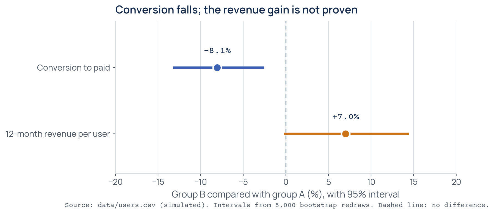
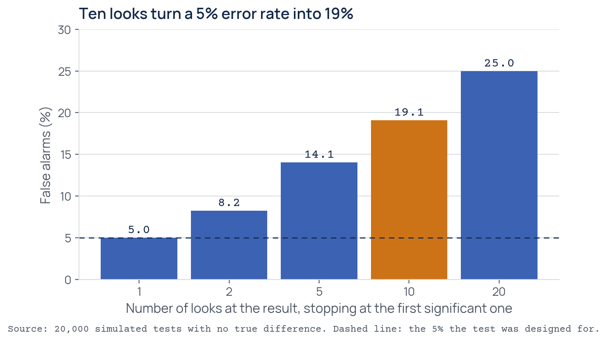
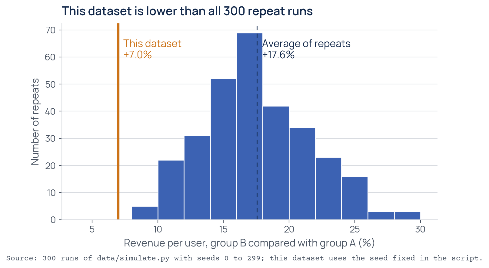
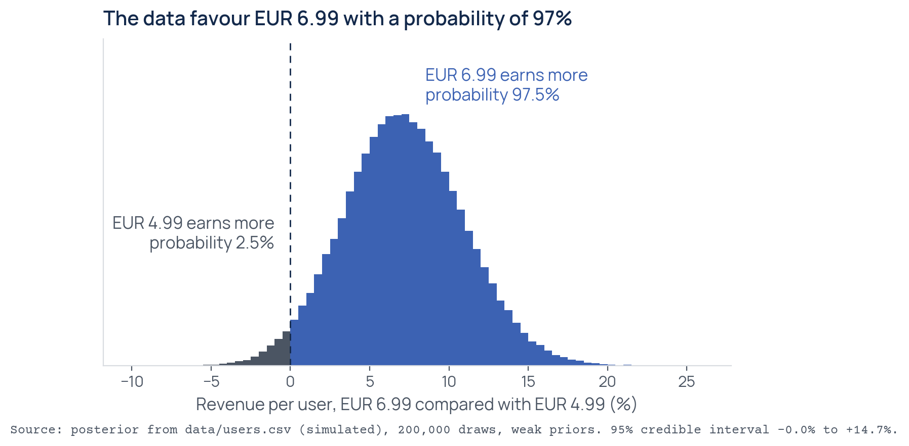

# Paywall price test

Should a free app charge **EUR 4.99** or **EUR 6.99** a month for its paid tier?

This repository designs and analyses a price experiment on simulated users, shows three classic mistakes, and ends with a decision.

**Website:** [valeriolomonaco.com/app-paywall-price-test](https://valeriolomonaco.com/app-paywall-price-test/), the same story as one scrolling page with animated charts. The full notebook is readable there too, as [a web page](https://valeriolomonaco.com/app-paywall-price-test/notebook.html).

## The decision

> **Keep EUR 4.99 for now, and run a confirmation test before switching to EUR 6.99.**
> The higher price lowers conversion by 8%. It raises 12-month revenue per user by an estimated 7%, but this test cannot tell that gain from chance (95% interval -0.3% to +14.4%).



| | EUR 4.99 | EUR 6.99 | Change | Significant at 5%? |
|---|---|---|---|---|
| Conversion to paid | 5.04% | 4.63% | -8.1% | Yes (p = 0.005) |
| Months paid per payer | 7.2 | 6.0 | -16.9% | not tested on its own |
| 12-month revenue per user | EUR 1.82 | EUR 1.95 | +7.0% | No (p = 0.055) |

The rule was fixed before the results: switch only if revenue per user is higher **and** the gain is distinguishable from chance. It is higher, but not distinguishable, so the test does not allow the switch. A new test sized for revenue (about 96,000 users per group) would settle it.

**All data is simulated.** See [Limitations](#limitations) before using any number.

## The question

A free app has a paid tier behind a paywall. Users who reach the paywall are split at random into two groups. Group A sees EUR 4.99 a month, group B sees EUR 6.99. A higher price brings more revenue per payer, but fewer users pay and they may cancel sooner. The test measures which effect is stronger.

The decision rests on one metric: **12-month revenue per user who saw the paywall**.

## Three traps

The notebook also breaks its own rules on purpose, to show what each one protects against.

| Trap | The mistake | What the notebook shows |
|---|---|---|
| Peeking | Stopping the test as soon as it looks significant | Ten looks turn a 5% false-alarm rate into 19% |
| Novelty effect | Judging the test on its first days | In week 1 the conversion gap is -3.9%; in weeks 2 to 8 it is -8.7% |
| The wrong metric | Judging on a metric that sees part of the picture | Conversion says -8%, revenue per paying user says +16%, revenue per user says +7% |



## One more finding: a correct test can still mislead

The simulation is built so that EUR 6.99 is the better price. Repeating the experiment 300 times, the gain averages 17.6% and the test finds a significant gain in all 300 runs. The dataset analysed here is lower than all 300 repeats: an unlucky draw. It was kept on purpose, because choosing a dataset for its result would be cherry-picking.



## The same method on open data

Part 5 of the notebook applies the same tools to two public datasets made by other people. Neither is a price test; they check the method, not the decision.

| Dataset | What the method finds |
|---|---|
| A/B test with revenue, 10,000 rows | A quarter of the users are in both groups. After cleaning, about fifty payers per group decide nothing, and one customer moves the estimate from -62% to -35%. |
| Marketing A/B test, 588,101 users | Conversion is 2.55% against 1.79% (p < 0.001). The smaller group, 4% of users, sets the precision. |

## A Bayesian reading

Part 6 looks at the same test as probabilities. With weak priors, the probability that EUR 6.99 earns more per user is 97.5%, and keeping EUR 4.99 carries an expected loss about 210 times larger than switching.

This does not overturn the decision. With this much data the Bayesian probability is almost the same number as one minus the one-sided p-value, so both views measure the same evidence. They differ in the threshold: the rule fixed in advance asks for 97.5% in the direction of the gain, and a common Bayesian rule asks for 95%. Over 2,000 simulated tests with equal prices, the 95% rule switches wrongly about twice as often (5.9% against 3.1%). The threshold has to be chosen before the test.



## What is in the repository

| Path | Content |
|---|---|
| `data/simulate.py` | Generates the simulated users from stated assumptions and a fixed seed |
| `data/users.csv` | One row per user, 89,658 rows |
| `notebooks/paywall_price_test.ipynb` | The notebook: design, analysis, traps, decision, limitations |
| `notebooks/paywall_price_test.py` | The same code as one plain Python file |
| `figures/` | The nine charts exported from the notebook |
| `data/open/README.md` | Where to download the two open datasets used in part 5 |
| `docs/index.html` | One-page scrolling website with the results |
| `docs/notebook.html` | The notebook as a web page, with code and results |
| `tools/build_site.py` | Builds the website from the data, so its numbers cannot drift |

## Progress

- [x] 1. Set up the repository
- [x] 2. Simulate the data
- [x] 3. Design the test: metric, power, sample size
- [x] 4. Analyse: conversion and revenue per user
- [x] 5. Show the traps: peeking, novelty effect, the wrong metric
- [x] 6. Decide
- [x] 7. Check the method on two open datasets
- [x] 8. Add a Bayesian reading of the test
- [x] 9. Build the website
- [x] 10. Publish

## How to reproduce

```
pip install -r requirements.txt
python data/simulate.py
```

Then open `notebooks/paywall_price_test.ipynb` and run all cells. It takes a few minutes, mostly for the 300 repeats.

## Limitations

- **All data is simulated.** No real users, no real app, no real payments. The results describe the assumptions written at the top of `data/simulate.py`, not any market.
- **The assumptions are placeholders**, chosen for illustration and not estimated from data.
- **The dataset is one unlucky draw**, kept on purpose (see above).
- **The test is sized on conversion but decided on revenue**, which is noisier.
- **The decision follows a rule fixed in advance.** A different significance level would give a different answer on the same data.

The notebook ends with the full list of 19 limitations and a disclaimer. This repository is an exercise in method. It is not pricing advice.

## Licence

Code and text are released under the MIT licence (see `LICENSE`). The fonts in `docs/fonts/` are under the SIL Open Font License (see `docs/fonts/OFL.txt`). The two open datasets keep their own licences and are not redistributed here.
